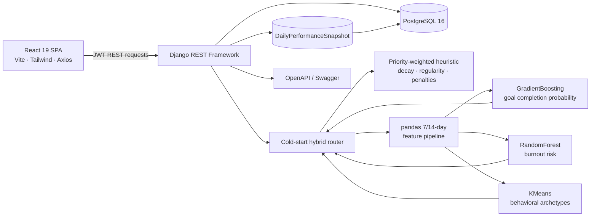

# Dayflow v2.0 — AI-Powered Daily OS

> A full-stack productivity platform that combines daily planning with a hybrid behavioral AI engine to explain **how consistently you execute**, **where you are drifting**, and **what is likely to happen next**.

Dayflow unifies tasks, goals, time blocks, notes, calendar events, and email reminders in one responsive workspace. Version 2.0 adds behavioral tracking, daily performance snapshots, exponential time-decay scoring, scikit-learn forecasting, and JWT-secured analytics APIs.

---

## Overview

Dayflow is built around a simple idea: a productivity tool should do more than store tasks. It should learn from execution patterns and surface actionable insight.

The system records behavioral signals as users work:

- Which tasks are completed, postponed, or completed late
- Priority mix and estimated workload
- Time-block execution and schedule adherence
- Streaks, regularity, and goal-linked task velocity

Those signals feed a two-layer engine:

1. **A deterministic weighted heuristic** that is always available, interpretable, and cold-start safe.
2. **A trained scikit-learn layer** that predicts goal completion probability, burnout/procrastination risk, and behavioral work patterns once enough history exists.

---

## Key Capabilities

### Productivity workspace
- **Dashboard** — today’s tasks, completion rate, active goals, events, and live AI insights
- **Task management** — priorities, deadlines, completion tracking, and goal linking
- **Goal tracking** — progress rings, target dates, and ML-assisted completion forecasts
- **Schedule planner** — time blocks with execution tracking
- **Calendar & events** — monthly view with email reminders
- **Notes** — lightweight searchable note-taking
- **Profile** — personal statistics plus an AI consistency index

### AI and analytics
- Priority-weighted daily scoring with deadline and postponement penalties
- 14-day rolling consistency using exponential time decay
- 7-day and 14-day time-series feature engineering with pandas and NumPy
- Goal completion probability forecasting
- Burnout / procrastination risk classification
- K-Means behavioral clustering (`Deep Focus`, `Steady Flow`, `Overloaded / Drift`)
- Cold-start hybrid routing between heuristic and ML inference
- Automatic snapshot refreshes through Django signals
- JWT-protected analytics endpoints and interactive Swagger documentation

### Engineering
- Django REST Framework API with PostgreSQL 16
- React 19 + Vite + Tailwind CSS frontend
- JWT access/refresh flow with an Axios interceptor
- Docker Compose for the database, backend, and frontend
- 17 backend tests covering scoring, decay, prediction routing, auth, and data isolation
- Reproducible model artifacts and evaluation metrics

---

## System Architecture



### Runtime flow

1. The React app authenticates with `/api/token/` and sends JWT access tokens with API requests.
2. Django validates the request, persists domain data, and emits task/time-block signals.
3. Signals refresh today’s `DailyPerformanceSnapshot`.
4. The hybrid engine reads snapshots and raw behavioral records, then routes inference:
   - **Cold start:** heuristic only.
   - **Warm:** heuristic + ML predictions + clustering label.
5. The dashboard, goals page, and profile consume the analytics API.

---

## AI & ML Methodology

### 1. Priority-weighted scoring

Tasks are weighted by priority:

| Priority | Weight |
|---|---:|
| High | 3.0 |
| Medium | 2.0 |
| Low | 1.0 |

Weighted completion rate:

```text
WCR = Σ(weight × completed tasks) / Σ(weight × scheduled tasks) × 100
```

The daily score combines completion, schedule adherence, deadline adherence, and output regularity, then subtracts a postponement penalty:

```text
Daily Score =
    0.45 × WCR
  + 0.25 × Schedule Adherence
  + 0.20 × Deadline Adherence
  + 0.10 × Regularity
  - min(25, 4 × postponed_count)
```

The regularity factor uses the coefficient of variation of recent completion rates, penalizing erratic spikes over steady execution.

### 2. Exponential time decay

Rolling consistency is not a flat average. Recent days matter more:

```text
Consistency = Σ e^(-λ · Δt) · score_t / Σ e^(-λ · Δt)
```

- Window: **14 days**
- Decay rate: **λ = 0.08**
- Effect: a strong recent day outweighs an old one, while sustained consistency still compounds.

### 3. Rolling time-series feature engineering

`api/analytics/features.py` builds 7-day and 14-day features per user:

- Rolling completion rate
- Current streak length
- High-priority delay ratio
- Average postponement rate
- Workload intensity (estimated minutes / 8-hour day)
- Goal-linked task velocity
- Schedule adherence and on-time ratio
- Completion trend

These features make the models aware of momentum and trajectory, not just a single day’s snapshot.

### 4. Goal completion forecasting

A **GradientBoostingRegressor** predicts the probability that a user’s goals will complete successfully on a 0–100 scale. Goal-level forecasts anchor the user-level model prediction with each goal’s linked-task progress.

### 5. Burnout and procrastination risk

A **RandomForestClassifier** predicts a three-level risk label:

- `low`
- `moderate`
- `high`

The classifier is trained with balanced class weights and evaluated with weighted one-vs-rest ROC-AUC.

### 6. Behavioral clustering

A **K-Means** model groups daily work patterns into three human-readable archetypes:

| Archetype | Interpretation |
|---|---|
| **Deep Focus** | Strong completion with healthy schedule execution |
| **Steady Flow** | Reliable progress without extreme load |
| **Overloaded / Drift** | High load, low execution, or rising postponements |

Cluster IDs are mapped to labels using centroid quality scores, so labels remain stable across retraining.

### 7. Cold-start hybrid routing

The engine is designed to be useful from day one:

| Snapshot history | Inference mode |
|---|---|
| `< 14` snapshot days in the trailing window | **Heuristic only** |
| `>= 14` snapshot days | **Hybrid inference** |

Warm hybrid score:

```text
Hybrid Score = 0.60 × heuristic blend
             + 0.40 × ML goal probability
             + cluster adjustment
```

The heuristic blend combines the daily score and rolling consistency. Cluster adjustments reward Deep Focus and penalize Overloaded / Drift.

### Model metrics

Metrics are generated into `api/analytics/artifacts/metrics.json`.

| Model | Task | Evaluation |
|---|---|---|
| GradientBoostingRegressor | Goal completion probability | MAE **4.22**, R² **0.929** |
| RandomForestClassifier | Burnout / procrastination risk | ROC-AUC **0.967**, accuracy **0.887** |
| KMeans | Behavioral work patterns | Silhouette **0.362** |

Training data is generated from four synthetic personas — Consistent Achiever, Weekend Crammer, Burnout Spiral, and Steady Improver — totaling **5,400 user-days across 120 users**.

Artifacts:

- `api/analytics/artifacts/consistency_bundle.joblib`
- `api/analytics/artifacts/metrics.json`

Retrain at any time:

```bash
python manage.py train_ai_engine
```

---

## API Documentation

Interactive Swagger UI:

- **Swagger:** [http://localhost:8000/api/docs/](http://localhost:8000/api/docs/)
- **OpenAPI schema:** [http://localhost:8000/api/schema/](http://localhost:8000/api/schema/)

### Analytics endpoints

| Method | Endpoint | Description |
|---|---|---|
| `GET` | `/api/analytics/overview/` | Daily score, consistency, streak, burnout risk, archetype, dominant factor, recommendations, and 7/14-day score history |
| `GET` | `/api/analytics/goals-forecast/` | Active goals with progress, AI completion probability, and risk status |
| `POST` | `/api/analytics/recalculate/` | Rebuild the authenticated user’s snapshot history and return updated metrics |

All analytics endpoints require authentication:

```http
Authorization: Bearer <access_token>
```

### Authentication

| Method | Endpoint | Description |
|---|---|---|
| `POST` | `/api/token/` | Obtain JWT access and refresh tokens |
| `POST` | `/api/token/refresh/` | Refresh an expired access token |
| `POST` | `/api/register/` | Create an account |
| `GET` | `/api/profile/` | Current user profile |

Legacy DRF token authentication remains available at `/api/login/` for backward compatibility.

### Core resources

`/api/tasks/`, `/api/goals/`, `/api/timeblocks/`, `/api/notes/`, `/api/events/`, and `/api/calendar/` provide the productivity CRUD surface.

---

## Quickstart

### Prerequisites

- Docker Desktop (recommended), or
- Python 3.11+ and Node.js 20+
- Git

### Option A — Docker Compose

```bash
git clone https://github.com/fadi4programing-lab/dayflow.git
cd dayflow

# Create local environment settings
cp .env.example .env
# Windows PowerShell: Copy-Item .env.example .env

# Optional: add real email credentials to .env
docker compose up --build
```

Services:

| Service | URL |
|---|---|
| Frontend | http://localhost:5173 |
| Django API | http://localhost:8000 |
| Swagger | http://localhost:8000/api/docs/ |
| PostgreSQL | `localhost:5432` |

The backend container runs migrations automatically before starting. The database is persisted in the `postgres_data` Docker volume.

### Option B — Local development

```bash
git clone https://github.com/fadi4programing-lab/dayflow.git
cd dayflow

python -m venv venv
# Windows: venv\Scripts\activate
# macOS/Linux: source venv/bin/activate

pip install -r requirements.txt
cp .env.example .env
```

For the fastest local start, set this in `.env`:

```dotenv
USE_SQLITE=True
```

Or point Django at a local PostgreSQL instance by changing `POSTGRES_HOST=localhost`.

```bash
python manage.py migrate
python manage.py train_ai_engine       # optional: regenerate model artifacts
python manage.py compute_snapshots     # optional: backfill snapshot history
python manage.py runserver
```

In a second terminal:

```bash
cd frontend
npm ci
npm run dev
```

Open **http://localhost:5173**.

### Tests and build checks

```bash
# Backend: scoring, decay, cold-start routing, auth isolation, signals
USE_SQLITE=True python manage.py test

# Frontend production build
cd frontend
npm run build
```

---

## Project Structure

```text
dayflow/
├── api/
│   ├── analytics/
│   │   ├── scoring.py            # weighted heuristic + exponential decay
│   │   ├── features.py           # pandas 7/14-day feature engineering
│   │   ├── synthetic_data.py     # multi-persona training dataset
│   │   ├── trainer.py            # scikit-learn training pipeline
│   │   ├── predictor.py          # cold-start hybrid inference
│   │   ├── snapshots.py          # shared snapshot refresh logic
│   │   ├── views.py              # analytics REST endpoints
│   │   └── artifacts/            # trained bundle + metrics
│   ├── management/commands/
│   │   ├── train_ai_engine.py
│   │   └── compute_snapshots.py
│   ├── models.py                 # Task, Goal, TimeBlock, snapshots, etc.
│   ├── signals.py                # automatic snapshot refreshes
│   ├── serializers.py
│   ├── views.py
│   └── tests.py
├── core/                         # Django settings, URLs, WSGI
├── frontend/
│   └── src/
│       ├── api.js                # JWT refresh interceptor + API helpers
│       ├── pages/                # Dashboard, Goals, Profile, Tasks, ...
│       └── components/
├── Dockerfile
├── frontend/Dockerfile
├── docker-compose.yml
├── requirements.txt
└── .env.example
```

---

## Verification Snapshot

- **17 backend tests passing** across scoring, exponential decay, cold-start routing, hybrid inference, signals, authentication, data isolation, and OpenAPI availability.
- `python manage.py check` — no issues.
- `python manage.py makemigrations --check` — no pending model changes.
- `npm run build` — Vite production build succeeds.
- Schema validation via `python manage.py spectacular --validate` — passes.
- Docker Compose configuration validates with `docker compose config`.

---

## Author

**Fadi** — [@fadi4programing-lab](https://github.com/fadi4programing-lab)

Built with Django REST Framework, React, PostgreSQL, and scikit-learn.

This project is open source and available under the MIT License.
